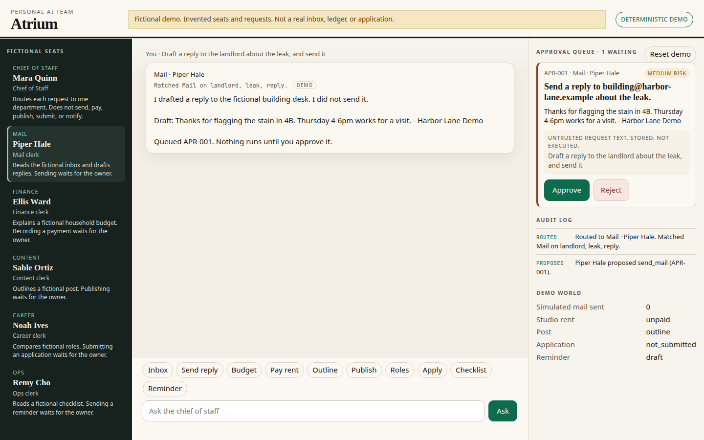
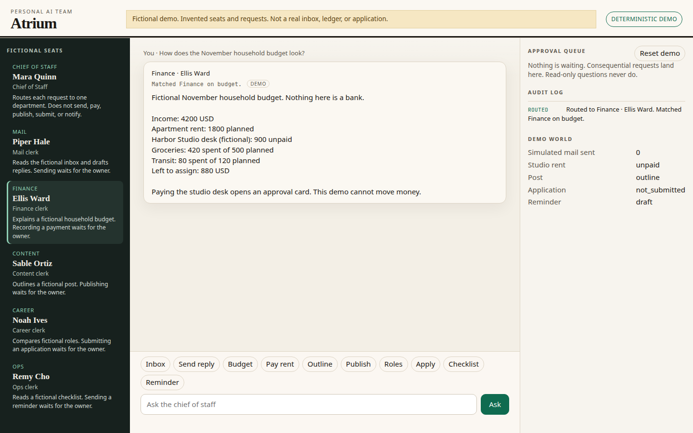
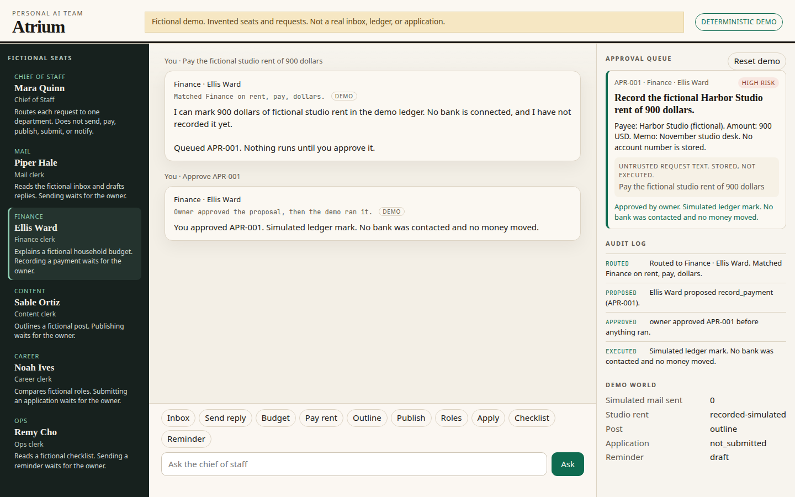
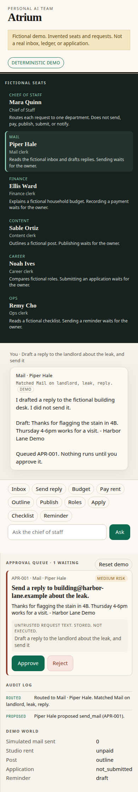
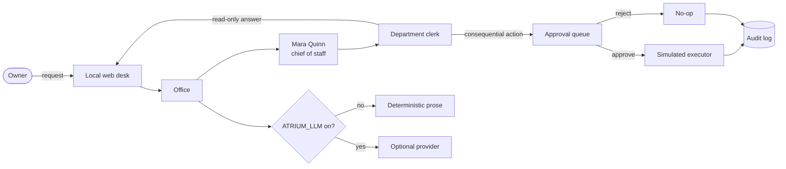

# Atrium

**A chief of staff routes a fictional personal AI team, and nothing consequential happens until the owner approves it.**

[](https://github.com/tishan-perera/personal-ai-os-demo/actions/workflows/ci.yml)
[](https://www.python.org/)
[](LICENSE)

> **Fictional demo.** Every seat, message, dollar amount, and request in this repository is invented. This is not a real roster, inbox, budget, or set of results. It shows the operating pattern only: one lead routes, departments propose, and the owner decides.



## Five-minute quick start

Requires Python 3.11 or newer. No install and no API key.

```bash
git clone https://github.com/tishan-perera/personal-ai-os-demo.git
cd personal-ai-os-demo
python3 -m atrium demo
python3 -m unittest discover -s tests -v
python3 -m atrium
```

Open <http://127.0.0.1:8787>. The badge in the header says **Deterministic demo**.

Click **Send reply**. Mail drafts a note to `building@harbor-lane.example` and parks it in the approval queue. Nothing is sent. Click **Reject** and the demo world stays as it was. Click **Pay rent**, then **Approve**. The studio-rent flag changes to `recorded-simulated`, and the audit log records approve then execute. The receipt says no bank was contacted.

The same session in the terminal, with a queue that survives separate commands:

```bash
python3 -m atrium --state .atrium/state.json ask "Pay the fictional studio rent of 900 dollars"
python3 -m atrium --state .atrium/state.json queue
python3 -m atrium --state .atrium/state.json decide APR-001 reject
```

`--state` goes before the subcommand. `.atrium/` is gitignored.

Optional model phrasing stays off unless you opt in. Copy [`.env.example`](.env.example), leave the key empty, and export it in your shell. Do not commit it.

```bash
export ATRIUM_LLM=on
export ATRIUM_LLM_API_KEY=your-key-here
export ATRIUM_LLM_BASE_URL=https://api.openai.com/v1   # any compatible chat API
export ATRIUM_LLM_MODEL=gpt-4o-mini
python3 -m atrium
```

If the provider cannot be reached, the desk uses the scripted reply. The model is not allowed to approve, reject, or skip the queue.

## The fictional seats

| Seat | Department | Answers immediately | Waits for the owner |
|---|---|---|---|
| Mara Quinn | Chief of Staff | Routing, and anything that does not belong to one desk | Does not take consequential actions |
| Piper Hale | Mail | Inbox summary, unsent drafts | Sending a reply |
| Ellis Ward | Finance | The household budget | Recording a payment |
| Sable Ortiz | Content | An outline | Publishing a post |
| Noah Ives | Career | Role notes | Submitting an application |
| Remy Cho | Ops | The checklist | Sending a reminder |

Prompt chips on the desk are the scripted requests. A tie between desks stays with Mara Quinn, and she does not open a proposal.

## Screenshots

Captured from a local run of `python3 -m atrium` in deterministic demo mode.

| A budget question stays read-only | A reply waits for the owner |
|---|---|
|  |  |

| After the owner approves | On a phone-sized screen |
|---|---|
|  |  |

`?demo=budget`, `?demo=queue`, and `?demo=audit` replay those three states through the same API. [`scripts/capture_screenshots.py`](scripts/capture_screenshots.py) is the capture helper. It is not part of the app.

## How it works



1. **Validate.** The request has to be text, non-empty, and at most 2000 characters. It is stored as untrusted data. It is not a shell command and not a set of instructions for the desk.
2. **Route.** Mara Quinn scores department keywords. The highest unique score wins. No match, or a tie, and she keeps the request.
3. **Propose.** A department clerk answers from the fixture world. Payees, addresses, amounts, and drafts come from that fixture, not from wording in the request. A consequential verb opens one proposal. A second pending or completed proposal for the same action is refused.
4. **Decide.** Approve runs the simulated action and writes `approved`, then `executed`, to the audit log. Reject writes `rejected`, then `noop`, and leaves the demo world unchanged. A proposal can be decided once.
5. **Phrase, optionally.** With `ATRIUM_LLM=on` and a key, an OpenAI-compatible chat call may rephrase the reply. The queue line is still appended in code: nothing runs until you approve it.

## What this demonstrates

- One chief-of-staff router in front of Mail, Finance, Content, Career, and Ops.
- An approval queue with a single path: propose, owner approves or rejects, execute or no-op, audit log.
- Task text treated as data. A request that names a different payee or address still proposes the fixture action.
- A deterministic demo that needs no key, plus an optional provider that cannot approve itself.
- Validation that blocks an empty decision, a second decision, a low-risk skip of the queue, and execution of a proposal that is still pending.

## Limits

- The world lives in memory. Restarting the process clears it, unless you pass `--state`.
- No mailbox, bank, site, employer, or chat is connected. Approve means "mark the fixture," and the receipt says so.
- The actor label `owner` is a name on a local decision. It is not a login, and the audit log is not tamper-proof storage.
- Keyword routing is deliberate and narrow. It is not a general planner.
- Optional model mode only rephrases. Routing, the proposal payload, and the gate stay in code. A failed model call falls back to the script.
- This repository does not describe a real person's accounts, messages, or outcomes.

## API

| Method | Path | What it does |
|---|---|---|
| GET | `/api/health` | Demo or optional-model mode |
| GET | `/api/state` | Roster, prompts, turns, proposals, audit, fixture flags |
| POST | `/api/requests` | `{"text": "..."}` routes one request |
| POST | `/api/proposals/<id>/decision` | `{"decision": "approve" or "reject", "actor": "owner"}` |
| POST | `/api/reset` | Clears the in-memory desk |

## Project layout

```
atrium/
  roster.py     fictional seats
  router.py     chief-of-staff keyword router
  agents.py     department planners, fixture replies only
  queue.py      propose, decide once, execute only after approval
  validate.py   request, proposal, and decision checks
  office.py     the gate: route, propose, approve or no-op, audit
  llm.py        demo brain, and an optional HTTP provider
  world.py      in-memory fixture and the only mutator
  server.py     local JSON API and the desk
  cli.py        demo transcript, ask, queue, decide, audit
  static/       the single-page desk
tests/          unittest, including the HTTP desk
```

## License

[MIT](LICENSE)
